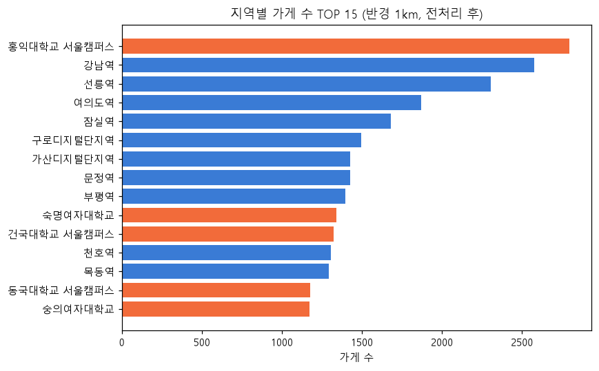
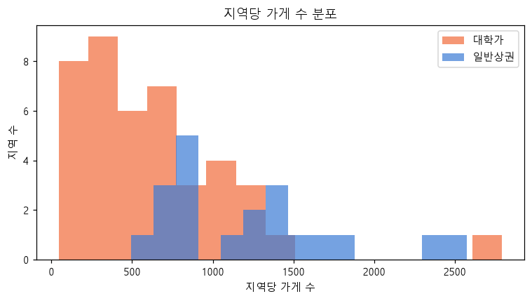
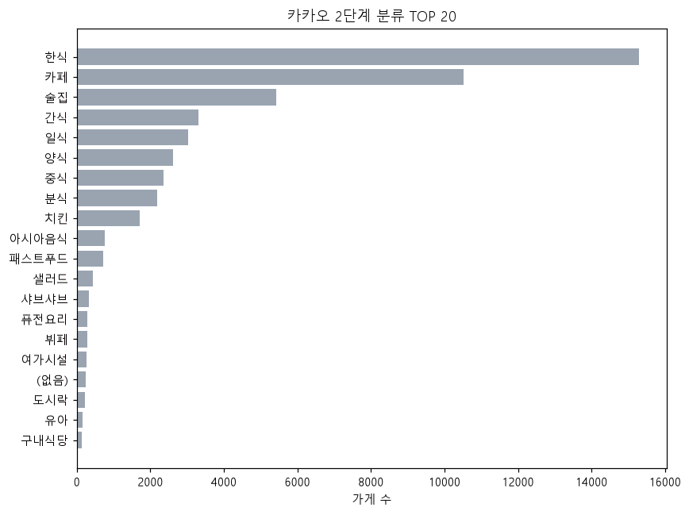
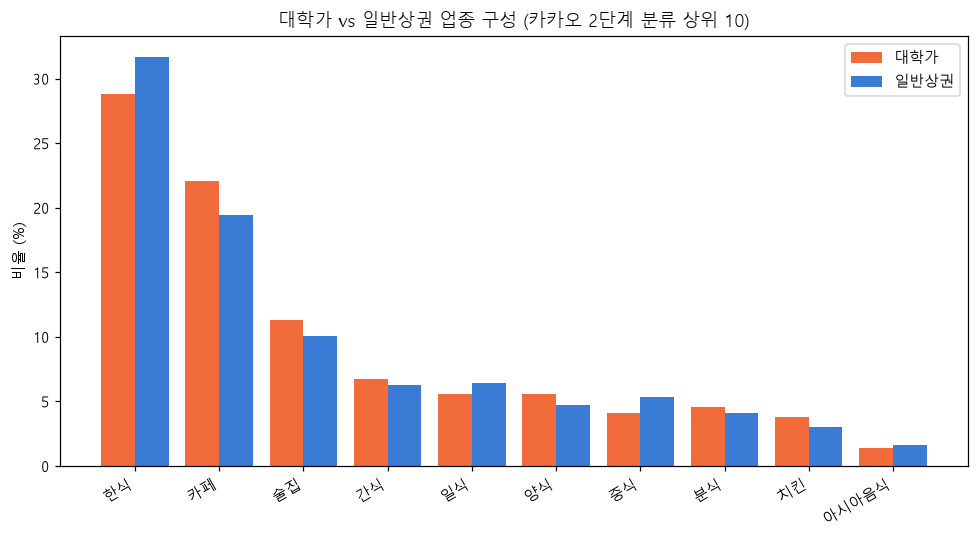
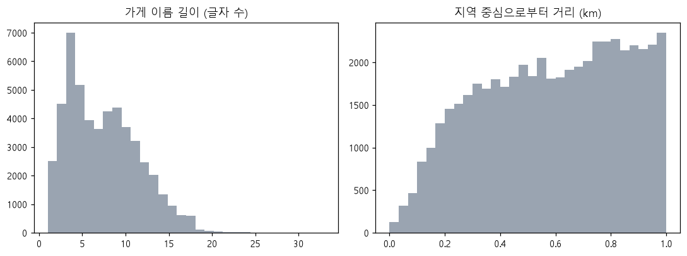
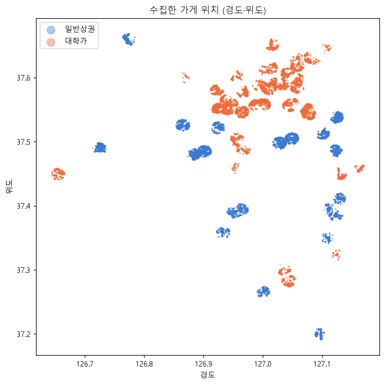
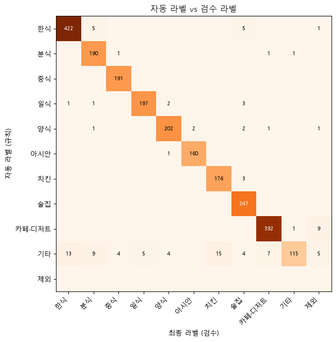

# 캠슐랭 데이터 분석: 대학가 음식점 업종 구조와 학생 관점 업종 라벨링 데이터셋 구축

> 웹 서비스 **캠슐랭**(학교 인증 기반 대학가 맛집 지도)의 '음식 종류' 분류를 데이터로 뒷받침하기 위한 분석 프로젝트

## 1. 문제 정의 및 결론에 대한 가설

**문제 정의**

- 캠슐랭은 가게를 등록할 때 사용자가 음식 종류를 직접 고른다. 카카오 지도의 기본 분류는 '음식점 > 한식'처럼 얕거나, 학생들이 실제로 쓰는 구분(술집·분식·카페 등)과 맞지 않는 경우가 많다.
- 대학가 상권이 일반 상권과 실제로 다른 구조인지 데이터로 확인하고, 학생 관점의 업종 라벨 데이터셋을 만들어 가게 이름·분류만으로 업종을 자동 추천할 수 있는지 검증한다.

**가설**

- **H1.** 대학가(대학 반경 1km)는 일반 상권보다 분식·술집·카페·디저트 비중이 높다. (카이제곱 검정)
- **H2.** 카카오 기본 분류만으로는 학생 관점의 분류가 부족하다. → 2단계 이하의 얕은 분류 비율과 규칙 라벨의 오류율이 의미 있는 수준이다.
- **H3.** 검수한 라벨로 학습한 모델이 규칙 기반 라벨보다 정확하다. → 캠슐랭 가게 등록 시 업종 자동 추천에 활용

## 2. 확보한 데이터의 양

- 출처: **카카오 로컬 API**(공식 Open API) 카테고리 검색 — 음식점(FD6)·카페(CE7)
- 대상: 대학가 42곳 + 비교용 일반 상권(지하철역) 20곳, 각 중심 반경 1km
- 수집 방식: 반경을 덮는 사각형으로 검색하고, 결과가 45건(API 한도)을 넘으면 4등분하여 누락 없이 수집

| 전처리 단계 | 건수 |
|---|---|
| 원본 (지역별 수집 합계) | 71,937 |
| 반경 1km 밖 제거 | 58,583 |
| 음식점·카페 외 제거 | 58,583 |
| 이름·좌표·분류 누락 제거 | 58,583 |
| 중복 가게 제거 (가장 가까운 지역 1곳만) | 50,598 |
| 일반상권 중 대학 1.5km 이내 제거 | 50,598 |

**전처리 후 최종 50,598건** 대학가 26,033건 / 일반상권 24,565건

## 3. 원본 데이터에 대한 EDA

- 원본 71,937행, 고유 가게 59,289곳 (여러 지역에 중복 수집된 행 12,648건)
- 컬럼: `area_name`, `area_type`, `area_lat`, `area_lng`, `place_id`, `place_name`, `category_name`, `category_group_code`, `address_name`, `road_address_name`, `phone`, `x`, `y`, `dist_km`, `collected_at`
- 빈 값 비율(%): phone 29.5, road_address_name 0.3, category_name 0.0
- 카카오 분류 깊이 분포: {'1': 238, '2': 14772, '3': 21913, '4': 12508, '5': 1167} → **2단계 이하(예: '음식점 > 한식')인 가게 29.7%**
- 2단계 분류 종류 27개, 3단계 321개

**지역별 가게 수 TOP 15**



**지역당 가게 수 분포**



**카카오 2단계 분류 TOP 20**



**대학가 vs 일반상권 업종 구성**



**이름 길이·거리 분포**



**수집 위치**



## 4. 데이터 라벨링에 대한 정의

- 라벨링 대상: 가게 1곳 = 1건, 입력 텍스트 = `가게 이름 | 카카오 분류`
- 라벨: 캠슐랭의 음식 종류를 학생 관점으로 세분화한 **10개 클래스 + 제외**
- 상세 기준과 경계 사례는 [`labeling_guide.md`](labeling_guide.md) 참고

| 라벨 | 정의 | 예시 |
|---|---|---|
| 한식 | 밥·국·찌개·고기구이·국밥·냉면·횟집 등 한국 음식 위주 식당 | 김치찌개집, 삼겹살집, 국밥, 횟집, 백반 |
| 분식 | 김밥·떡볶이·라면·토스트·도시락 등 간단하고 저렴한 한 끼 | 김밥천국, 엽기떡볶이, 이삭토스트, 한솥 |
| 중식 | 짜장면·짬뽕·탕수육·마라탕·양꼬치 등 중국 음식 | OO반점, 마라탕, 양꼬치 |
| 일식 | 초밥·라멘·돈까스·우동·덮밥 등 일본 음식 (식사 위주) | 스시, 라멘집, 돈까스 전문점 |
| 양식 | 파스타·피자·햄버거·스테이크·브런치 등 서양 음식 | 맘스터치, 피자집, 파스타집 |
| 아시안 | 베트남·태국·인도·튀르키예·몽골 등 아시아 음식 (멕시칸은 양식) | 쌀국수, 팟타이, 인도커리, 케밥 |
| 치킨 | 치킨이 주 메뉴인 가게 (포장·배달 위주 포함) | BBQ, 교촌, 동네 통닭 |
| 술집 | 술이 주 목적인 가게. 이름에 호프·포차·주점·펍·이자카야가 있으면 술집 | 치킨호프, 이자카야, 포차, 와인바 |
| 카페·디저트 | 커피·음료·빵·케이크·아이스크림 위주 | 스타벅스, 동네 빵집, 탕후루 |
| 기타 | 음식점은 맞지만 위 분류에 넣기 어려운 곳 (뷔페, 샐러드 등) | 샐러드 전문점, 뷔페 |
| 제외 | 음식점이 아니거나 폐업·판단 불가 | 편의점, 정육점, 반찬가게, 정보 없음 |

## 5. 데이터 라벨링 수행 과정

1. **규칙 기반 자동 라벨링 (전체)** — 카카오 분류 문자열에 키워드 규칙 R01~R09를 우선순위대로 적용, 해당 없으면 '기타'(R00)
2. **신뢰도 표시** — 분류가 2단계 이하이거나, 규칙 미해당이거나, 가게 이름 단서와 충돌(예: 분류는 치킨인데 이름에 '호프')하면 `low`
3. **층화 표본 추출** — 라벨별 최소 150건을 보장하여 약 2,400건 추출 (random_state=42)
4. **검수 (Claude(AI) 전수 검수)** — 표본 전체를 가게 이름·카카오 분류를 보며 1건씩 확인하고 `label_final`(드롭다운)을 수정, 확인 칸에 O 표시. `low` 행(노란색)을 먼저 검수
5. **품질 확인** — 자동 라벨 vs 최종 라벨 일치도(정확도, Cohen's kappa, 혼동행렬), (다음 단계) 사람이 표본을 독립적으로 다시 라벨링해 AI 검수와의 일치도(kappa) 측정
6. **데이터셋 구축** — '제외'를 뺀 확인 완료 행을 train/valid 8:2 층화 분할

**자동 라벨 결과 (전체)**

| 라벨 | 건수 | 비율(%) |
|---|---|---|
| 한식 | 15,577 | 30.8 |
| 카페·디저트 | 13,920 | 27.5 |
| 술집 | 5,439 | 10.7 |
| 양식 | 3,347 | 6.6 |
| 일식 | 3,089 | 6.1 |
| 분식 | 2,517 | 5.0 |
| 중식 | 2,363 | 4.7 |
| 기타 | 1,862 | 3.7 |
| 치킨 | 1,724 | 3.4 |
| 아시안 | 760 | 1.5 |

- 규칙 미해당('기타') 3.7%, 신뢰도 낮음 31.8%, 이름-분류 충돌 1.6%
- 검수 표본 2,400건

## 6. 라벨링 결과: 학습 데이터셋 구축

| 항목 | 값 |
|---|---|
| 검수 시트 행 수 | 2,400 |
| 검수 완료(확인 O) | 2,400 |
| 제외 라벨 | 16 |
| **최종 데이터셋** | **2,384건** |
| train / valid | 1,907 / 477 |
| 자동 라벨 수정 비율 | 4.5% |
| 자동 라벨 정확도 (kappa) | 95.5% (0.949) |
| 사람 표본 vs 검수 라벨 일치율 (kappa) | 미실시 (다음 단계) |

**라벨 분포**

| 라벨 | 건수 |
|---|---|
| 한식 | 436 |
| 카페·디저트 | 401 |
| 술집 | 264 |
| 양식 | 209 |
| 분식 | 206 |
| 일식 | 202 |
| 중식 | 196 |
| 치킨 | 191 |
| 아시안 | 162 |
| 기타 | 117 |

**검수에서 가장 많이 고친 경우**

| 자동 → 최종 | 건수 |
|---|---|
| 기타 → 치킨 | 15 |
| 기타 → 한식 | 13 |
| 기타 → 분식 | 9 |
| 카페·디저트 → 제외 | 9 |
| 기타 → 카페·디저트 | 7 |
| 기타 → 제외 | 5 |
| 한식 → 분식 | 5 |
| 한식 → 술집 | 5 |
| 기타 → 일식 | 5 |
| 기타 → 양식 | 4 |



- 파일: `data/dataset/train_dataset.csv`, `train.csv`, `valid.csv` (컬럼: place_id, place_name, category_name, area_type, text, label, label_auto, rule_id)

## 7. 가설 검증 (중간 결과)

- **H1**: 업종 구성(자동 라벨 기준) 카이제곱 검정 χ²=232.3, df=9, p=5.27e-45 → **유의함 (p<0.05)**

| 라벨 | 대학가(%) | 일반상권(%) |
|---|---|---|
| 분식 | 5.2 | 4.7 |
| 술집 | 11.4 | 10.1 |
| 카페·디저트 | 29.0 | 26.0 |

- **H2**: 카카오 분류 2단계 이하 29.7%, 규칙 라벨이 검수 라벨과 다른 비율 4.5%
- **H3**: valid 477건 기준 — 규칙 정확도 96.4% (macro F1 95.4) vs TF-IDF+로지스틱회귀 96.9% (macro F1 95.8)

> 다음 단계: 데이터셋으로 분류 모델을 고도화하고, 캠슐랭 가게 등록 화면의 '음식 종류 자동 추천'에 적용

## 재현 방법

```bash
pip install -r requirements.txt
# .env 에 KAKAO_REST_KEY=... (또는 ../campuslin/.env 사용)
python step1_collect.py
python step2_preprocess.py
python step3_eda.py
python step4_auto_label.py
# data/labeling/labeling_sheet.xlsx 검수
python step5_build_dataset.py
python step6_build_report.py
```

## 데이터 이용 안내

- 원본 데이터는 카카오 로컬 API로 수집했으며, 원본(`data/raw`)은 저장소에 올리지 않았다. API 키는 `.env`에만 보관한다.